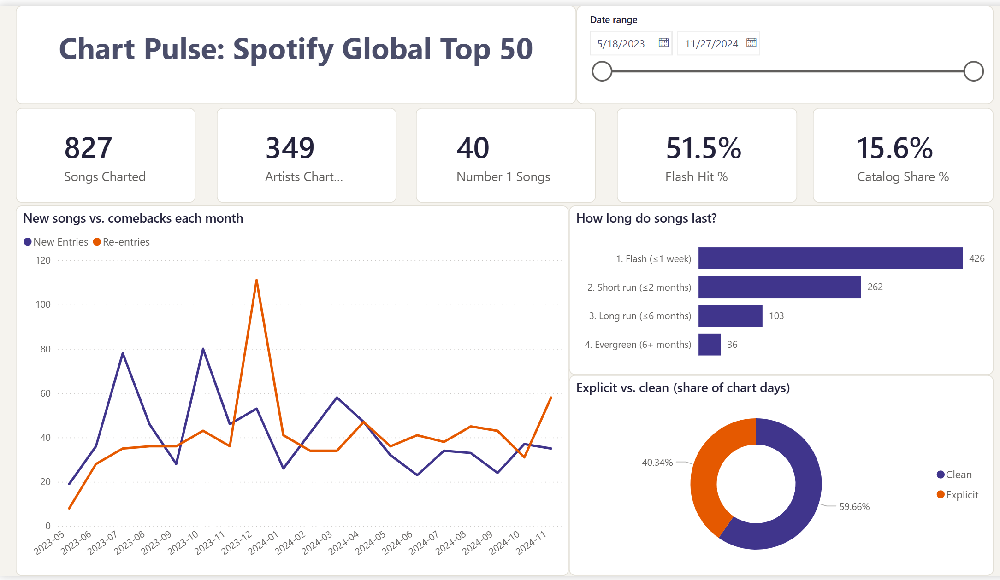
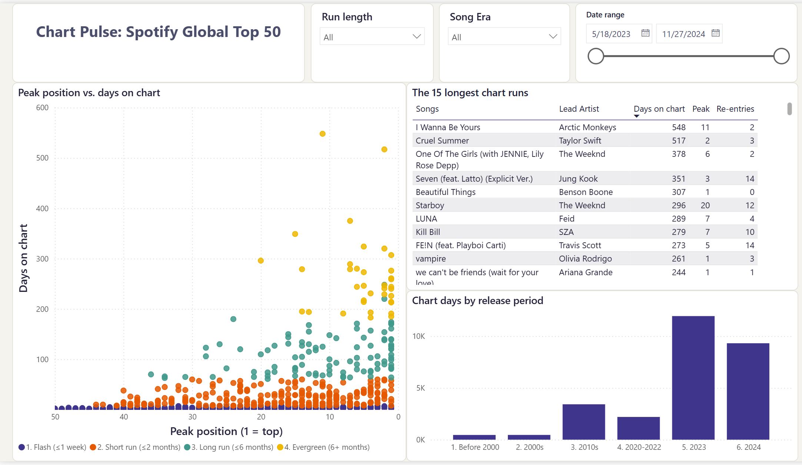
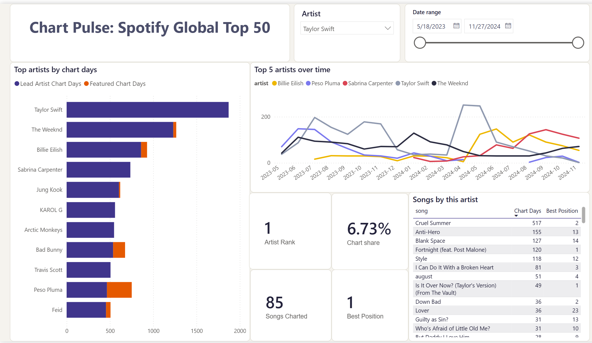
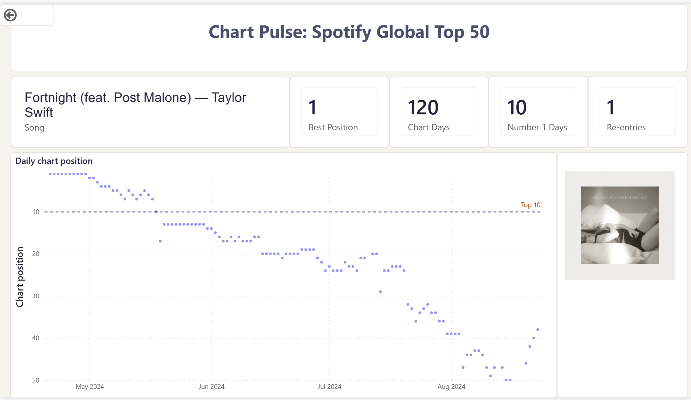

# Chart Pulse: what keeps a song in Spotify's Global Top 50?

A Power BI report built on 18 months of daily Spotify Top 50 (Global) charts, from May 2023 to November 2024.

Most Spotify dashboards I've seen look at popularity scores or song counts. I wanted to use the fact that this data is a *daily* chart and ask something different: **which songs actually stay, and who owns the chart over time?** A song that hits #1 for a week and disappears is a very different story from one that sits at #20 for a year and a half.



## Report pages

| Page | Question it answers |
|---|---|
| **Overview** | How busy is the chart? New entries, re-entries, how many songs burn out fast |
| **Staying Power** | Peak position vs. how long a song lasts, and which old songs keep coming back |
| **Artist Dominance** | Who holds the most chart days, counting features as well as lead credits |
| **Song Journey** | Drillthrough: one song's full day-by-day path through the chart |

## Screenshots

| Staying Power | Artist Dominance |
|---|---|
|  |  |

**Song Journey** (right-click any song on another page → Drill through):



## Things I found

- **Half the songs are gone within a week.** 52% of the 827 songs that charted lasted 7 days or less, and the median run is exactly 7 days. Only 36 songs stayed more than 6 months.
- **A long run and a high peak are not the same thing.** *I Wanna Be Yours* by Arctic Monkeys was on the chart every single day in the dataset (548 days) but never got higher than #11. *Die With A Smile* had the most days at #1 (77) but a much shorter run overall.
- **Old songs take up a real slice of the chart.** About 16% of all chart days went to songs released before 2020, including *Cruel Summer* (2019), *Sweater Weather* (2013) and *The Night We Met* (2015).
- **Taylor Swift's numbers come in waves.** She has the most chart days by far (1,871 across 85 songs), but 50 of those 85 songs lasted a week or less. Album releases flood the chart, then most tracks drop off.
- **Splitting collab credits changes the artist ranking.** If you take the raw artist field as-is, Billie Eilish is second. Once credits like "The Weeknd & JENNIE & Lily-Rose Depp" are split into individual artists, The Weeknd moves up to second with 1,266 chart days, mostly from *One Of The Girls* and *Starboy*.
- **Christmas takes over the chart every December.** Re-entries jumped to 111 in December 2023, the highest of any month, then 58 in November 2024 as the same songs came back. *All I Want for Christmas Is You* spent 27 days at #1, dropped off in January, and returned the next November. Almost every Christmas song left the chart by 27 December.
- **Some artists live on features.** 38% of Peso Pluma's 752 chart days came from songs where he wasn't the lead artist, and about 20% of Bad Bunny's. Taylor Swift, Sabrina Carpenter and KAROL G got all of their chart days as lead artists.
- **Songs chart fast or not at all.** For songs that debuted during this period, the median gap between release date and first chart day was 3 days.
- **Explicit content doesn't move the needle.** 40% of chart days are explicit tracks, and their average position is almost identical to clean ones.

## Data model

Star schema, built by `scripts/prepare_data.py` from the raw export:

```
             dim_date
                │
dim_song ── fact_chart_daily
   │
bridge_song_artist ── dim_artist
```

- `fact_chart_daily`: one row per song per day (27,800 rows), with position, day-to-day movement, and debut/re-entry/top-10/#1 flags
- `dim_song`: one row per song, with days on chart, peak, days at #1, re-entries, release-to-chart gap, and longevity tier
- `dim_artist` + `bridge_song_artist`: collab credits like "Peso Pluma & Anitta" are split so each artist gets credit (a handful of acts with "&" in their actual name, like Hall & Oates, are kept together)
- `dim_date`: calendar table

DAX measures are in [`powerbi/measures.dax`](powerbi/measures.dax), and the custom theme is in [`powerbi/chart_pulse_theme.json`](powerbi/chart_pulse_theme.json).

## Running it yourself

```bash
pip install -r requirements.txt
python scripts/prepare_data.py
```

Then open `powerbi/chart_pulse.pbix` in Power BI Desktop and hit Refresh. If the file paths break, point the CSV sources at your local `data/processed/` folder. [`docs/build_guide.md`](docs/build_guide.md) has the full setup if you want to rebuild the report from scratch.

The raw Excel file isn't included in the repo (see below). Download it and put it in `data/raw/` before running the script.

## Data notes

- Source: Spotify Daily Top 50 – Global, via [Spotify Global Top 50 (Daily Update) on Kaggle](https://www.kaggle.com/datasets/prathamsaraf1389/spotify-global-top-50-daily-update). 18 May 2023 to 27 Nov 2024.
- 4 days are missing from the source (14 Mar, 25 Mar, 11 Jul and 13 Aug 2024). Day-to-day movement treats a one-day gap as consecutive so those days don't create fake re-entries.
- Songs already on the chart on day one (18 May 2023) have runs longer than what's shown. They're flagged with `already_charting_at_start`.
- A few release dates only had a year or a year-month. Those were set to the first day of that period.
- In the data model, a song is a song title + artist credit, so versions with a different credit are separate rows. The Song Journey drill-through matches by title, so it combines versions of the same song released on different albums (for example, *One Of The Girls*).

## Tools

Power BI Desktop · DAX · Python (pandas) · Power Query

## Credits

The dataset was put together by prathamsaraf1389 on Kaggle (link above). The report, data model, and analysis in this repo are my own.

## What I learned

Building this taught me how much the data model matters: I had to use a bridge table so collaborations count for every artist, and setting up relationships, slicer interactions and drill-through showed me how one setting can change every number on a page. I was also surprised how much a daily chart reveals that a simple song list doesn't, like Christmas songs returning to the chart every November, and next I'd like to add audio features such as tempo and energy to see what long-lasting songs have in common.

---

Made by **Brijeshkumar Amin** · [LinkedIn](https://linkedin.com/in/brijeshkumar-amin)
