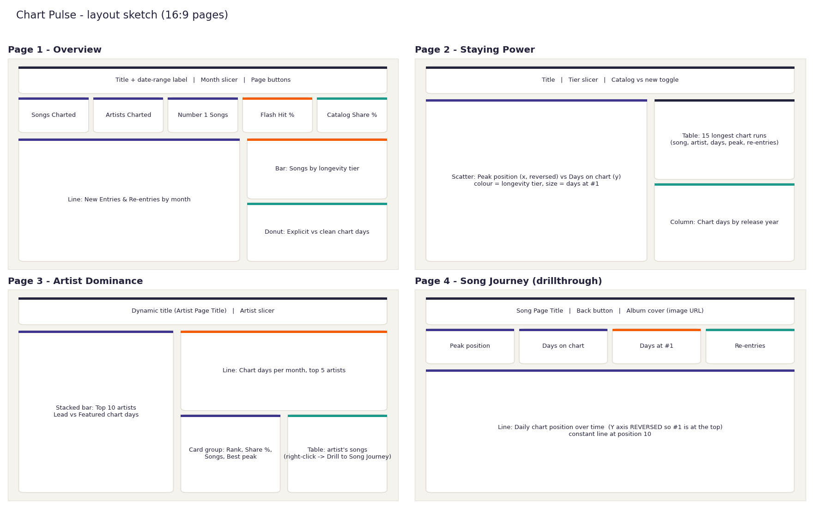

# Build guide

Notes on how the `.pbix` is put together, in case I (or anyone) need to rebuild it from the CSVs.

## 1. Load the data

1. Run `python scripts/prepare_data.py` so the five CSVs in `data/processed/` are up to date.
2. Power BI Desktop → **Get data → Text/CSV** → load all five files.
3. In Power Query check the types:
   - every `date`-style column → **Date** (not Date/Time)
   - `prev_position` and `position_change` → **Whole number** (blanks are expected, they mean the song wasn't on yesterday's chart)
   - the `is_...` flag columns → **Whole number**
4. Close & Apply.

## 2. Model

Set up these relationships (Model view):

| From | To | Cardinality | Cross-filter |
|---|---|---|---|
| `dim_date[date]` | `fact_chart_daily[date]` | 1 : * | Single |
| `dim_song[song_id]` | `fact_chart_daily[song_id]` | 1 : * | Single |
| `dim_song[song_id]` | `bridge_song_artist[song_id]` | 1 : * | **Both** |
| `dim_artist[artist_id]` | `bridge_song_artist[artist_id]` | 1 : * | Single |

The "Both" on the bridge is what lets an artist slicer filter the fact table through songs. Without it, picking "Peso Pluma" won't do anything to the chart-day numbers.

Then:
- Mark `dim_date` as a date table (Table tools → Mark as date table → `date`).
- Sort `dim_date[month]` by `month_num`.
- Hide the id columns and `bridge_song_artist` from report view so the field list stays clean.

## 3. Measures

Create an empty table called `_Measures` (Home → Enter data → name it, OK), then paste each measure from `powerbi/measures.dax` in as a new measure. Format the `%` ones as percentage with 1 decimal.

Note: `Flash Hit %`, `Evergreen Songs` and `Median Run Length` are based on each song's full run in the dataset, so they don't change with the month slicer. That's on purpose; a song's run length doesn't really make sense cut by month.

## 4. Theme

View → Themes → **Browse for themes** → `powerbi/chart_pulse_theme.json`.

Canvas: 16:9, 1280 × 720.

## 5. Pages

**Overview**
- 5 cards: Songs Charted, Artists Charted, Number 1 Songs, Flash Hit %, Catalog Share %
- Line chart: `dim_date[year_month]` on the axis, New Entries and Re-entries as values
- Bar chart: `dim_song[longevity_tier]` vs count of song_id
- Donut: Explicit Share % (or `dim_song[is_explicit]` as legend with Chart Days)
- Slicer: `dim_date[year_month]` (between / range style)

**Staying Power**
- Scatter: Details = `dim_song[song]`, X = `peak_position` (Don't summarize), Y = `days_on_chart` (Don't summarize), Legend = `longevity_tier`, Size = `days_at_number1`
  - Format → X axis → **Invert range: On**, so #1 sits on the right
- Table: song, lead_artist, days_on_chart, peak_position, reentries → Top N filter 15 by days_on_chart
- Column chart: `release_year` vs Chart Days

**Artist Dominance**
- Stacked bar: `dim_artist[artist]` with Lead Artist Chart Days + Featured Chart Days. Top N filter = 10 by Chart Days.
- Line: `year_month` on axis, Chart Days, `artist` as legend, filtered to top 5 artists
- Cards: Artist Rank, Artist Share of Chart %, Songs Charted, Best Position
- Table of the artist's songs
- Title: a text box (or card) driven by `Artist Page Title`

**Song Journey (drillthrough)**
- Page settings: Page type = Drillthrough, drillthrough field = `dim_song[song]`
- Line chart: `dim_date[date]` on X, `Best Position` on Y
  - Y axis → **Invert range: On**, start 1, end 50
  - Analytics → Constant line at 10 labelled "Top 10"
- 4 cards: Best Position, Chart Days, Number 1 Days, Re-entries
- Album cover: `dim_song[album_cover_url]` → set Data category to **Image URL**, show it in a Table or the new Image visual
- Title from `Song Page Title`

## 6. Last bits

- Add page navigation buttons (Insert → Buttons → Navigator → Page navigator)
- Turn off "Edit interactions" between the two Overview line/bar charts if the cross-highlight gets messy
- Take a screenshot of each page and save it to `images/` for the README
